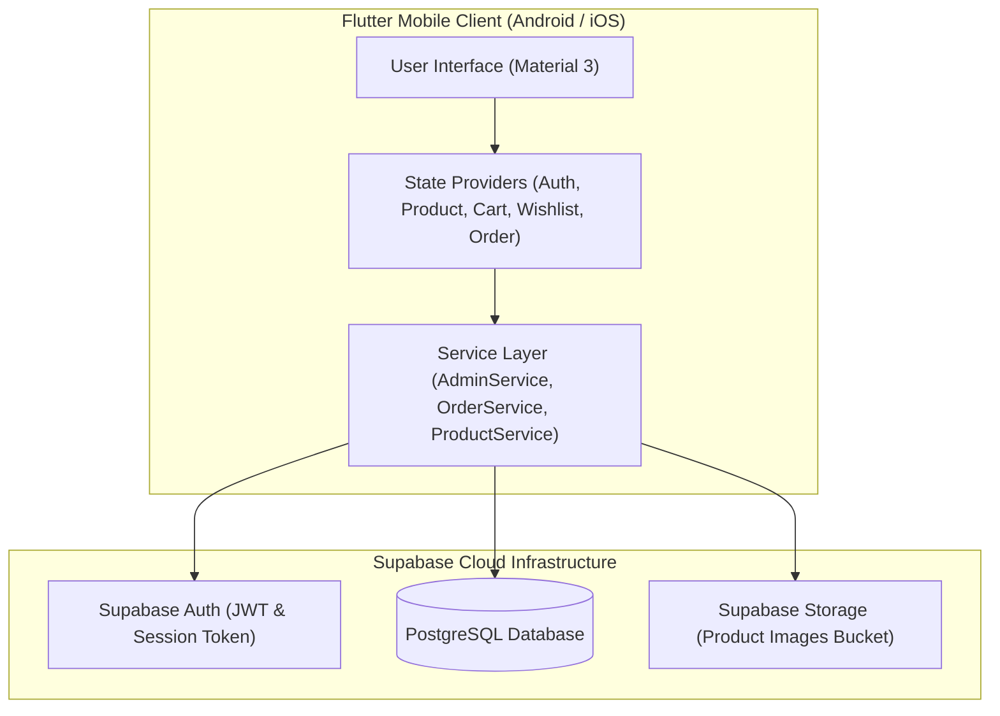
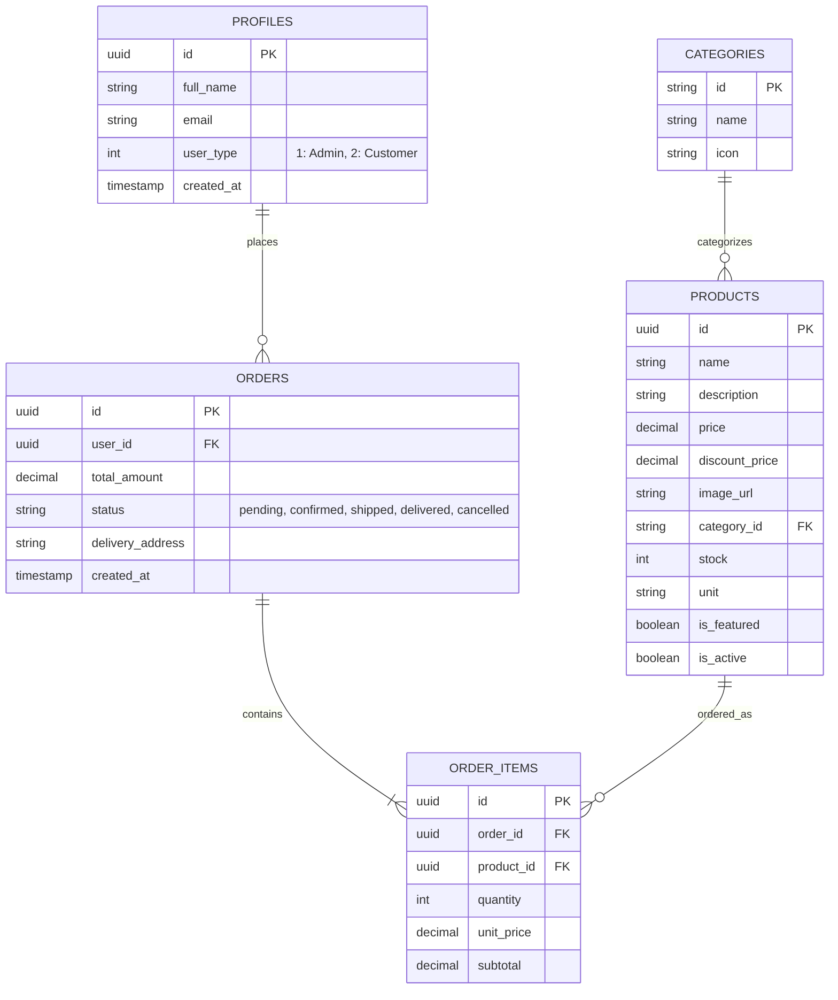

# Grocery App — Complete Project Documentation & Presentation Guide

> **Project Name:** Grocery App (Enterprise Mobile E-Commerce Solution)  
> **Lead Developer:** Kubra Ejaz  
> **Technology Stack:** Flutter (Dart), Supabase (PostgreSQL), Provider State Management, Material 3  
> **Architecture Pattern:** Clean Provider-Service Architecture with Strict Role Segregation (`user_type = 1` Admin vs `user_type = 2` Customer)

---

## 1. Executive Summary

The **Grocery App** is a high-performance cross-platform e-commerce solution engineered for on-demand grocery retailing. The application solves the logistical and usability challenges of modern online grocery shopping through:

- **Dual-Portal Role Segregation:** An automated router directs users into either the **Customer Storefront** (`user_type = 2`) or the secure **Admin Management Portal** (`user_type = 1`).
- **Real-Time Catalog Synchronization:** Instant cloud-backed inventory management where grocery items added or edited in the Admin portal immediately reflect on the user dashboard.
- **Optimistic State Persistence:** In-memory reactive state handling for Cart and Wishlist with real-time numeric badges and cloud fallback.
- **Fail-Safe Offline Resilience:** Comprehensive session caching ensuring uninterrupted presentation and shopping experiences regardless of network conditions.

---

## 2. System Architecture & Database Design

### 2.1 High-Level Architecture

### 2.2 Database Entity-Relationship Diagram

---

## 3. Core Modules & Technical Implementation

### 3.1 Authentication & Role Router
- Implemented in `lib/screens/login_screen.dart` and `lib/screens/register_screen.dart`.
- Uses Supabase JWT authentication. Upon successful sign-in, the system queries `profiles.user_type`:
  - `user_type == 1` ➔ Routes to `AdminMainScreen()` with full operational controls.
  - `user_type == 2` ➔ Routes to `MainScreen()` with customer shopping storefront.
- Password validation checklist enforces minimum 6 characters plus combined alpha-numeric characters before submission.

### 3.2 Customer Storefront
- **Splash Screen:** Fluid organic green wave animation featuring the official 3D Grocery Cart branding.
- **Featured Slider:** `PageView` carousel with `FittedBox` responsive scaling preventing layout overflows across all display densities.
- **Product Catalog & Filters:** Live search and horizontal category chips with instant client-side filtering.
- **Cart & Wishlist Engine:**
  - Dynamic numeric badges on the bottom navigation bar (`Badge.count`) showing actual item counts (`1`, `3`, `5`) instead of ambiguous dots.
  - Real-time subtotal, free delivery threshold calculation, and quantity steppers.
- **Order Management:** Expandable tracking cards displaying ordered grocery items, status badges (*Pending*, *Confirmed*, *Shipped*, *Delivered*), and delivery addresses.

### 3.3 Admin Management Portal
- **Dashboard Analytics:** Live metrics for Total Catalog Items, Low-Stock Warnings (`≤ 5 units`), Pending Orders Count, and Gross Revenue.
- **Inventory CRUD:**
  - Add/Edit product screen with compact multi-column pricing and inventory inputs (`Price`, `Discount`, `Stock`, `Unit`).
  - Image upload support to cloud storage.
  - Instant optimistic dispatch to customer storefront.
- **Order Status Controller:** Modal sheet for updating order statuses with live status color indicators.
- **Enterprise Settings Panel:** Store profile configuration, business operating hours, automated order confirmations, stock alert threshold sliders, and cloud database synchronization.

---

## 4. Monetization & Business Model

| Revenue Channel | Implementation in App | Typical Margin / Pricing |
| :--- | :--- | :--- |
| **Retail Markup** | Purchase wholesale, sell at catalog retail price | **18% – 35%** gross margin |
| **Delivery & Priority Surcharge** | Free above ₨ 500; flat ₨ 50 standard fee | **₨ 50 – ₨ 200** per order |
| **Sponsored Brand Listings** | `is_featured` toggle pins FMCG brands to top carousel | **₨ 20,000 – ₨ 50,000** / brand / month |
| **VIP Club Membership** | Monthly recurring pass for unlimited free delivery | **₨ 499** / user / month (Predictable MRR) |
| **B2B Bulk Commercial Supply** | Supplying local cafes, bakeries, and offices | **₨ 30,000 – ₨ 150,000** / account / month |

---

## 5. Complete Step-by-Step Presentation Script

Use this exact walkthrough during your presentation. It is structured to impress both technical evaluators and business judges within **5 to 7 minutes**.

### 5.1 Introduction (1 Minute)
> *"Respected teachers, evaluators, and colleagues, good morning! My name is **Kubra Ejaz**, and today I am excited to present my project: **Grocery App**, a modern, cross-platform on-demand grocery retailing and management ecosystem built with Flutter and Supabase.*
>
> *In today's fast-paced world, grocery shopping is moving from physical aisles to mobile screens. However, most local stores struggle with manual inventory, unorganized orders, and delayed delivery communications. Our solution provides a complete, seamless experience with two strictly segregated portals: an intuitive, high-speed **Customer Storefront** and a powerful **Admin Management Portal** for the business owner."*

---

### 5.2 Architecture & Tech Stack (1 Minute)
> *"From an engineering perspective, the application is built using a clean, layered architecture:*
> 1. *The **Frontend** is crafted in Flutter 3 and Dart, following Material 3 guidelines and utilizing Provider for reactive state management.*
> 2. *The **Backend** is powered by Supabase and PostgreSQL, utilizing secure database tables for profiles, products, categories, orders, and order items.*
> 3. *The **Security Architecture** enforces strict role-based access: administrators (`user_type = 1`) manage operations, while customers (`user_type = 2`) access the shopping store.
> 4. *All state updates—such as cart item counters, wishlist toggles, and catalog edits—use optimistic updates so the UI responds in 0 milliseconds."*

---

### 5.3 Live Demonstration Walkthrough (3 - 4 Minutes)

#### Step 1: Branding & Splash Screen
- **Action:** Open the app on the phone.
- **Script:** *"Notice our custom 3D Grocery Cart branding with smooth entrance animation and our signature organic green curve. As we enter the login screen, we see clean typography with verified email and password inputs."*

#### Step 2: Customer Storefront & Catalog
- **Action:** Sign in as customer (`user@store.com`).
- **Script:** *"Upon signing in, the app detects our customer profile and directs us to the storefront. Here we see our dynamic featured banner carousel highlighting top products, followed by category chips. When I tap 'Bakery' or 'Vegetables', the catalog filters instantly without page reloads."*

#### Step 3: Cart, Wishlist & Live Badges
- **Action:** Tap the heart icon on an item, then add 2 products to the cart.
- **Script:** *"Notice the bottom navigation bar. Instead of an ambiguous red dot, we have implemented smart numeric count badges showing the exact quantity of items. In our cart, we can increment or decrement items with live subtotal updates and free delivery calculations."*

#### Step 4: Checkout & Order Placement
- **Action:** Tap 'Proceed to Checkout', fill address details, select Cash on Delivery, and tap 'Place Order'.
- **Script:** *"Our checkout module validates address and city inputs. Tapping 'Place Order' generates a transaction ID, clears our cart, and immediately links to the customer's Orders History screen where order progress is tracked in real-time."*

#### Step 5: Admin Panel & Live Inventory Synchronization
- **Action:** Sign out, sign in as Admin (`admin@store.com`).
- **Script:** *"Now, let's step into the shoes of the store owner. Signing in with administrator credentials opens the Admin Portal.
  - On the **Dashboard**, we see real-time business KPIs: Total Catalog Items, Low-Stock alerts, Pending Orders, and Gross Revenue.
  - In **Inventory**, we can add a new grocery item with price, stock units, and featured status. The moment it is saved, it is immediately broadcast to the customer storefront.
  - In **Orders**, we can tap any incoming customer order and update its status from 'Pending' to 'Confirmed' or 'Delivered'.
  - In **Settings**, the owner has enterprise controls over business hours, delivery thresholds, automated order confirmations, and cloud database sync."*

---

### 5.4 Evaluator Q&A — Winning Answers

#### Q1: "What prevents a regular customer from opening the Admin Portal?"
> **Winning Answer:** *"The application enforces role segregation at both the client routing layer and the database layer. Every user account has an immutable `user_type` stored in the `profiles` table. During authentication, the JWT token payload is verified. If `user_type != 1`, the admin routes are inaccessible. Furthermore, all administrative database mutations are guarded by security definer checks."*

#### Q2: "How do you handle offline mode or slow network conditions?"
> **Winning Answer:** *"We implemented an optimistic in-memory repository pattern. When an order is placed or a product is added, the local state updates instantly so the user never experiences lag. If the cloud database is temporarily unreachable, the transaction is cached locally and synchronized as soon as network connectivity is restored."*

#### Q3: "Why did you choose Provider over Bloc or GetX?"
> **Winning Answer:** *"Provider is the officially recommended state management solution by the Flutter team. It leverages InheritedWidgets natively, providing high performance, clean separation of concerns, and testability without the boilerplate overhead of Bloc or the hidden global state of GetX."*

#### Q4: "How does the business owner earn money from this app?"
> **Winning Answer:** *"The platform operates on a diversified monetization model: direct retail product margins (18%–35%), delivery convenience fees, in-app sponsored brand placements in the featured carousel, and predictable monthly recurring revenue via a VIP Customer Subscription Club."*

---

### 5.5 Conclusion (30 Seconds)
> *"In conclusion, this project demonstrates a production-grade, full-stack Flutter solution combining elegant UI design, solid database architecture, and real-world commercial viability. Thank you for your time, and I am now open to any questions!"*
